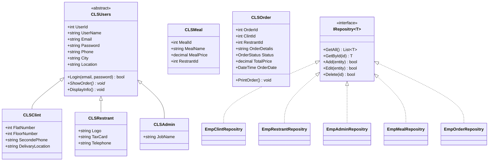
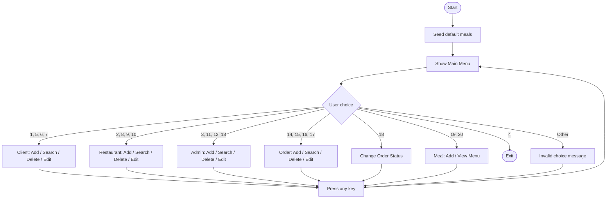
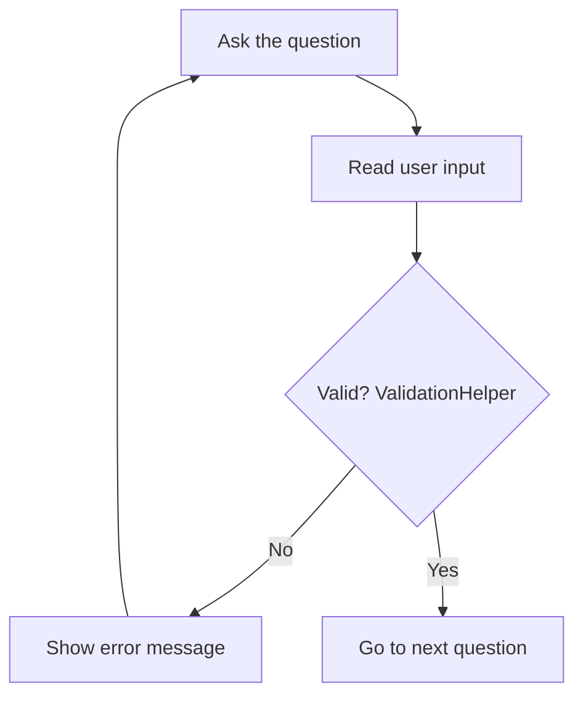
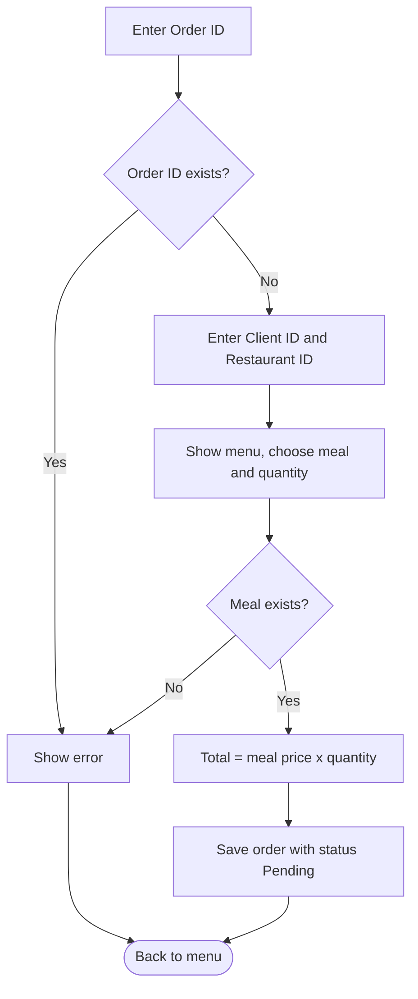
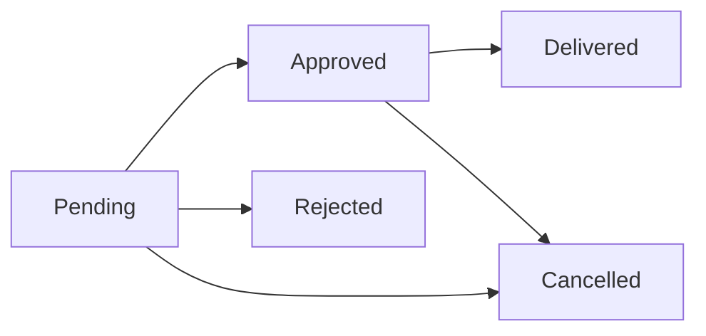

# RestrantAPP

A restaurant ordering console application built with **C#** to practice **Object-Oriented Programming** (inheritance, abstraction, encapsulation, polymorphism) and the **Repository pattern**.

## Features

- Manage **Clients**, **Restaurants** and **Admins** (add, search, edit, delete)
- Manage the **Menu** (add meals, view all meals)
- Create and manage **Orders** (add, search, edit, delete, change status)
- Total price is calculated automatically from the meal price and quantity
- **Input validation**: if the user enters something invalid, the program shows an error and asks the same question again
- Data is stored in memory using generic repositories

## Tech Stack

- C# (.NET 6 or later)
- Console application (top-level statements)
- No external packages

## Project Structure

```
RestrantAPP/
├── Program.cs                  # Console UI and main menu
└── Classes/
    ├── CLSUsers.cs             # Abstract base class for all users
    ├── CLSClint.cs             # Client (inherits CLSUsers)
    ├── CLSRestrant.cs          # Restaurant (inherits CLSUsers)
    ├── CLSAdmin.cs             # Admin (inherits CLSUsers)
    ├── CLSMeal.cs              # Meal
    ├── CLSOrder.cs             # Order + OrderStatus enum
    ├── IRepositry.cs           # Generic repository interface
    ├── EmpClintRepositry.cs    # Client repository
    ├── EmpRestrantRepositry.cs # Restaurant repository
    ├── EmpAdminRepositry.cs    # Admin repository
    ├── EmpMealRepositry.cs     # Meal repository
    ├── EmpOrderRepositry.cs    # Order repository
    ├── ValidationHelper.cs     # Validation rules
    └── InputHelper.cs          # Reads input and re-asks until it is valid
```

## Class Diagram



## Program Flow



## Input Validation Flow

Every text, number and price the user enters goes through the same loop. The program does not move to the next question until the answer is valid.



### Validation rules

| Field | Rule |
|---|---|
| Name | Must not be empty |
| Email | Must be a valid email format |
| Phone | 11 digits and starts with `01` |
| Password | At least 8 characters |
| Price | A number greater than 0 |
| Numbers (IDs, flat, floor) | Must be a valid integer |
| Other text fields | Must not be empty |

## Add Order Flow



## Order Status Flow



Available statuses: `Pending`, `Approved`, `Rejected`, `Delivered`, `Cancelled`.

## Main Menu

| Entity | Add | Search | Delete | Edit |
|---|---|---|---|---|
| Client | 1 | 5 | 6 | 7 |
| Restaurant | 2 | 8 | 9 | 10 |
| Admin | 3 | 11 | 12 | 13 |
| Order | 14 | 15 | 16 | 17 |

| Option | Action |
|---|---|
| 18 | Change order status |
| 19 | Add a new meal |
| 20 | View the menu |
| 4 | Exit |

## Getting Started

### Prerequisites

- [.NET SDK](https://dotnet.microsoft.com/download) 6.0 or later
- Visual Studio 2022 (optional)

### Run

```bash
git clone https://github.com/AbdullahMandour/Project-OOP-C-.git
cd Project-OOP-C-
dotnet run --project RestrantAPP
```

Or open `RestrantAPP.sln` in Visual Studio and press **F5**.

## How to Use

Data is stored in memory only, so it resets every time the program closes. To place an order:

1. Choose **1** and register a client.
2. Choose **2** and register a restaurant with ID **100** (the default meals belong to restaurant 100).
3. Choose **14** to create the order using the same client and restaurant IDs.
4. Choose **18** to approve or reject the order.

## Known Limitations and Future Work

- [ ] Store data in a database (SQL Server / SQLite) instead of in-memory lists
- [ ] Hash passwords instead of storing plain text
- [ ] Implement real login for each user type
- [ ] Support multiple meals in one order
- [ ] Fix spelling in class and member names (`Clint` → `Client`, `Restrant` → `Restaurant`, `Repositry` → `Repository`)

## Author

**Abdullah Mandour** ([@AbdullahMandour](https://github.com/AbdullahMandour))
